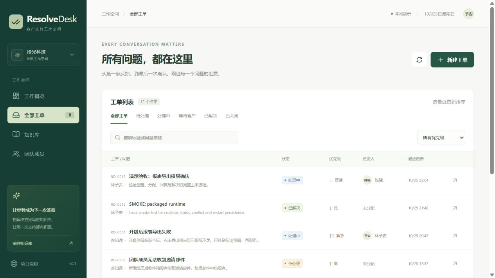

# ResolveDesk

面向小型软件团队的多租户工单与知识库工作台。当前版本 **0.1.0，本地开发演示**。

这份项目面向 Java 后端求职：用可以运行的业务流程展示权限隔离、事务一致性、状态机与乐观锁，并逐步扩展检索、异步任务和 AI 质量评测。



## 已实现

- Spring Security 会话登录、BCrypt 密码哈希、CSRF 防护、退出登录。
- 企业隔离；客户只能读取及回复自己创建的工单；客服与管理员可处理企业内工单。
- 工单创建、搜索、状态/优先级筛选、分页、负责人分配、回复、操作记录。
- 明确的状态转换规则、版本号乐观锁、事务内写入审计记录。
- 知识文章创建、发布/草稿、阅读；客户看不到草稿。
- **关键词演示回复辅助**：只检索本企业已发布文章，附来源，人工审核后发送。当前没有真实大模型、向量检索或异步索引。
- 两个虚构企业、五个演示账号、十一个初始工单和六篇文章。
- React + TypeScript 自适应页面；Java 集成测试；CI 配置。

## Windows 快速运行

仓库保存源码、测试与构建配置。以下步骤从源码构建并运行；本地数据库、依赖缓存与打包程序不提交到 Git。

需要 Java 17+、Node.js 22.18+（推荐 24）与 PowerShell。首次安装需要联网；无需事先安装 Maven 或运行 Docker。

在项目目录打开 PowerShell：

```powershell
./scripts/setup.ps1
./scripts/start.ps1
```

启动脚本会构建前端、执行后端测试并打包，然后在前台运行服务。访问 **http://127.0.0.1:8080**，按 Ctrl+C 停止。端口占用时可运行 `./scripts/start.ps1 -Port 8081`。

工具和依赖缓存在项目内 `.tools/` 与 `.cache/`。本地 H2 数据保存在项目根目录 `.data/`，重启后保留。不要同时启动两个使用同一数据库文件的实例。

若系统拦截本地脚本，可在 PowerShell 中直接使用 `powershell -ExecutionPolicy Bypass -File ./scripts/setup.ps1`，再以相同方式运行 start 脚本；只对该进程生效。

### 演示账号

统一密码：`Demo@12345`。这些账号只适合本地虚构数据演示。

| 邮箱 | 企业 | 角色 |
| --- | --- | --- |
| admin@acme.demo | 拾光科技 | 管理员 |
| agent@acme.demo | 拾光科技 | 客服工程师 |
| customer@acme.demo | 拾光科技 | 客户 |
| customer2@acme.demo | 拾光科技 | 另一客户 |
| admin@north.demo | 北辰工作室 | 管理员 |

## 开发与验证

```powershell
./scripts/check.ps1
```

如在受限 Windows 环境遇到 javac 的 `ZipFS / AccessDenied` 路径解析异常，可显式运行 `./scripts/check-portable.ps1`，用 ECJ 编译相同源码，再运行同一套 JUnit 测试；它不会自动忽略失败。

有 Maven 时也可以分别执行：

```sh
mvn -f backend/pom.xml test
cd frontend
npm ci
npm run build
```

双服务开发：后端 `mvn spring-boot:run`（在 backend 目录）；前端 `npm run dev`（在 frontend 目录）。前端端口 5173，`/api` 代理到 8080。生产构建后也可 `npm run preview -- --port 5173`，用于无热更新的界面验证。

## PostgreSQL / Docker

```sh
docker compose up --build
```

访问 http://127.0.0.1:8080。默认端口仅绑定本机回环地址。Docker 环境会使用 PostgreSQL；Flyway 自动执行建表迁移。

此配置为开发演示配置，不是可直接公开的生产环境。生产化仍需账号管理、登录限流、HTTPS/Secure Cookie、密钥配置、备份与监控。当前没有注册、改密、邀请成员和管理员改角色接口。

## 三分钟演示

1. 管理员登录，展示工作概览、筛选和搜索。
2. 打开“升级后报表导出失败”，查看原始问题与操作记录。
3. 点击“知识辅助”，展示演示标记、文章引用，将草稿填入回复框并审核发送。
4. 分配负责人，推进到已解决，再关闭。
5. 在两个窗口打开同一工单，一处修改后另一处再提交，展示 409 冲突与输入保留。
6. 退出后切换北辰账号，验证只出现该企业的数据；切换客户账号验证权限收敛。

## 技术与范围

后端：Java 17、Spring Boot 3.5.7、Spring Security、Spring JDBC、Flyway、H2 / PostgreSQL。

前端：React 19、TypeScript、Vite、自定义 CSS 与 Lucide 图标。第一版使用轻量原生表单组件，避免在核心流程尚未稳定时引入额外组件层。

项目说明见 `docs/architecture.md`，后续任务见 `docs/roadmap.md`，实测记录见 `docs/verification.md`。

**没有声称已完成**：真实 LLM 接入、pgvector、知识版本历史、异步索引、生产监控、十万条数据压测、AI 评测与线上公开部署。这些属于后续里程碑。
