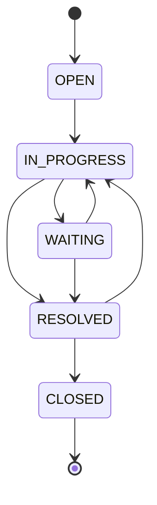

# 设计决策

## 请求路径

React 页面 → 同源 `/api` → Spring Security 会话与 CSRF → Controller 校验 → TicketService 事务 → JDBC / Flyway 数据库。

本地单服务模式由 Spring Boot 直接提供构建后的静态页面；开发模式由 Vite 代理 API。避免跨域 Cookie 与开放 CORS 的额外复杂度。

## 企业与角色边界

`WorkspaceUser` 从数据库加载，包含用户 ID、企业 ID 与角色。接口不接收客户端自报的企业 ID。每次工单、评论、事件、成员和知识查询均带服务端企业条件。

客户读取工单还必须满足 `created_by = 当前用户`；越权读取统一返回 404，避免暴露另一个企业的记录存在性。员工写操作首先验证角色，再验证资源归属。知识草稿不会出现在客户列表和辅助回复候选集中。

数据库复合外键把工单、评论、作者和负责人约束在同一企业。应用层检查与数据库约束分担不同责任。

## 状态机

已解决允许重新打开；已关闭为终态，不允许回复或重新分配。状态映射在服务端集中定义，页面只展示当前可执行的下一步。

## 并发和事务

工单修改请求必须携带读取时的 `version`。更新使用 `WHERE tenant_id=? AND id=? AND version=?`，成功后 `version + 1`。影响行数为 0 返回 409。状态变更、分配、回复写入与对应审计写入处于同一事务中。

回复也更新工单版本，因此“关闭工单”和“新增回复”并发发生时只允许一个旧版本请求成功。冲突时页面保留回复输入，要求刷新最新记录后重新确认。

实际并发测试使用两个线程、同一初始版本，同时更新状态，断言仅一个成功且仅产生一个状态审计事件。

## 检索辅助的真实能力

当前只做中文二元片段/词片段交集计数，取超过基础阈值的前两篇已发布文章，直接组装模板。它是显式标记的演示能力，不是生成式 AI，也没有准确率承诺。来源及正文可以展开，只有点击发送才生成客户回复。

后续替换为独立检索接口、向量/关键词混合召回、可配置模型适配器、结构化引用校验及离线评测。当前关键词方案保留为对照基线。

## 为什么采用模块化单体

个人项目首先需要完整业务闭环与可复现部署。后端按 auth、ticket、knowledge、shared 分包，用一份数据库完成事务。等异步索引和独立吞吐需求被实测确认后，再决定是否拆分独立 Worker。

## 数据库与已知边界

本地 H2 文件模式用于无需 Docker 的演示；Docker 配置使用 PostgreSQL。两者使用同一 Flyway 初始迁移，但 H2 测试不等价于 PostgreSQL 兼容性证明。后续加入 Testcontainers 的 PostgreSQL 回归测试。

第一版审计覆盖工单变更；知识文章只支持创建与阅读，不提供编辑、历史版本和删除。成员页面只读。指标为数据库当前计数，没有虚构增长率或性能数据。
